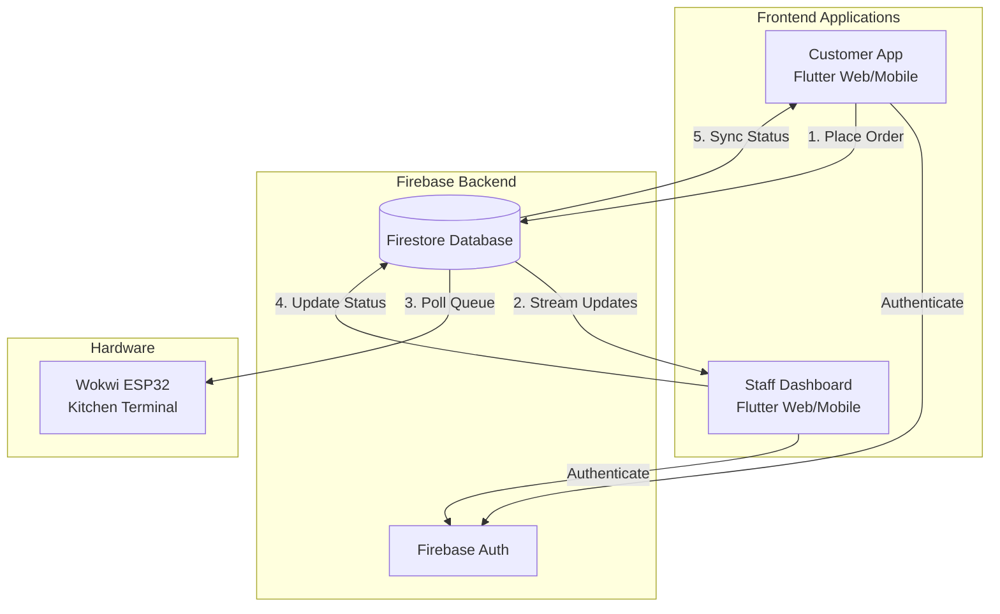

# Cafeana System Guide & Walkthrough

Welcome to the Cafeana system! This document provides a complete end-to-end guide on how your application works, the system architecture, and how data flows between the Customer App, the Staff Dashboard, and the Kitchen Hardware (Wokwi ESP32).

## 🏗️ System Architecture

Cafeana is built on a modern, reactive architecture using **Flutter** for the frontend, **Firebase** for the backend, and **C++ (ESP32)** for the hardware integration.

## 🔄 The Complete Order Flow

Here is exactly what happens when an order is placed, from the customer's phone to the kitchen buzzer, and back.

### 1. The Customer Places an Order
- **Action**: A customer opens the app, browses the menu, adds an "Americano" to their cart, and clicks "Checkout".
- **Backend**: The app creates a new document in the Firestore `orders` collection. The order is stamped with the customer's ID and its status is set to `queued`.
- **UI**: The customer is redirected to the "Order Tracking" page, where they see a progress bar indicating their order is currently "Queued".

### 2. The Hardware Reacts (Wokwi ESP32)
- **Action**: The ESP32 micro-controller in the kitchen is constantly listening to Firestore for any order with the status `queued`.
- **Hardware Trigger**: As soon as the new order hits the database, the ESP32 detects it.
- **Alert**: The ESP32 triggers a physical buzzer to alert the kitchen staff and displays the incoming Order Number (e.g., `#1004`) on its OLED screen.

### 3. The Staff Starts Preparing
- **Action**: The barista/kitchen staff hears the buzzer, looks at the Staff Dashboard on their tablet, and sees the new order in the **Live Order Queue**.
- **Backend**: The Staff Dashboard streams active orders in real-time. The staff clicks **"Start Preparing"**. This updates the order's status in Firestore from `queued` to `preparing`.
- **Hardware Sync**: The ESP32 sees that the status is no longer `queued`, so it turns off the buzzer and updates its screen to show it is now working on the order.
- **Customer Sync**: The customer's app instantly updates its progress bar to "Preparing".

### 4. Order is Ready for Pickup
- **Action**: The barista finishes making the coffee and clicks **"Mark as Ready"** on the Staff Dashboard.
- **Backend**: The status changes to `ready` in Firestore.
- **Customer Sync**: The customer's app updates to "Ready", notifying them to come pick up their drink at the counter.

### 5. Order is Completed
- **Action**: The customer picks up their drink. The staff clicks **"Complete Order"**.
- **Backend**: The status changes to `completed`. 
- **Analytics**: The order is removed from the active queue and its data is immediately fed into the **Staff Analytics Page**, updating the day's Total Revenue, Total Orders, and Top Products charts.

## 🛠️ Testing the Flow Yourself

Because Firebase Authentication shares sessions across browser tabs, you must test the Customer and Staff views in isolated environments to prevent role contamination (where the Staff app thinks it's a Customer).

**Step-by-Step Testing Guide:**
1. **Start the Web Server**: Run `flutter run -d web-server --web-port 8080`.
2. **Open the Staff Dashboard**: Open your normal Chrome browser and navigate to `http://localhost:8080`. Log in with a Staff account (e.g., `staff@cafeana.com`).
3. **Open the Customer App**: Open an **Incognito / Private Window** and navigate to `http://localhost:8080`. Log in with a Customer account (e.g., `customer@test.com`).
4. **Place an Order**: In the Incognito window, add items to your cart and checkout.
5. **Watch the Magic**: 
   - Look at the normal Chrome window; the order will instantly appear in the Staff Queue.
   - Click "Start Preparing" on the Staff screen.
   - Look back at the Incognito window; the customer's progress bar will instantly move to Preparing!

## 📂 Project Structure Highlights

- `mobile_web_app/lib/features/customer/`: Contains all UI and logic for the customer-facing app (Menu, Cart, Order History).
- `mobile_web_app/lib/features/staff/`: Contains the Staff Dashboard (Live Queue, Analytics, Inventory Management).
- `mobile_web_app/lib/core/providers/`: The central brain of the app using Riverpod for state management and Firestore streaming.
- `firmware/`: The C++ code for the ESP32 hardware terminal (configured for Wokwi simulation).
